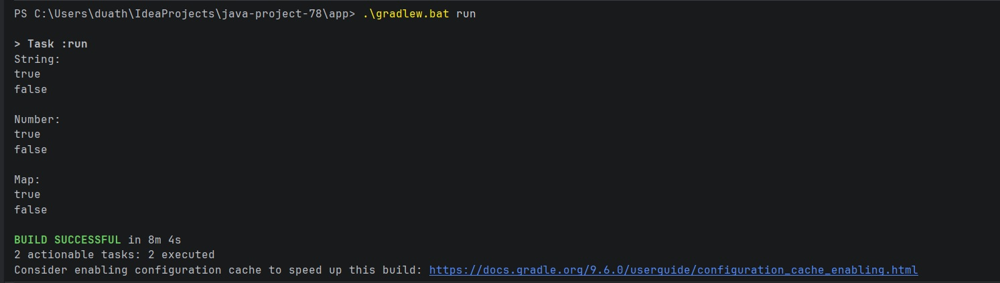

# Валидатор данных (Java)

[](https://github.com/DocLoki/java-project-78/actions)

[](https://github.com/DocLoki/java-project-78/actions/workflows/ci.yml)


Создание собственной библиотеки для проверки корректности (валидации) данных – отличный способ прокачать навыки проектирования кода, в особенности, объектно-ориентированной архитектуры. Создание правильных иерархий классов, расширяемая архитектура, применение принципов SOLID, использование fluent-интерфейса – все это предстоит делать в проекте

Учебный проект Хекслета: https://ru.hexlet.io/programs/java
Как это должно работать: https://asciinema.org/a/NtQ6xBownxYFN2H8WEffvtcS1

## Стек

- Java

## Установка

Для работы с проектом необходима установленная Java 21.

Клонируйте репозиторий:

```bash
git clone https://github.com/DocLoki/java-project-78.git
cd java-project-78 
```

Перейдите в каталог приложения и запустите сборку:
```
cd app
./gradlew build
```
Gradle автоматически загрузит необходимые зависимости.


## Использование
Валидатор позволяет создавать схемы проверки для разных типов данных, задавать ограничения и проверять значения.

Пример запуска:


---

<details>
<summary>Автоматические тесты Хекслета</summary>

Тесты запускаются на каждый коммит. За запуск отвечает файл `.github/workflows/hexlet-check.yml` — не удаляйте и не переименовывайте ни его, ни репозиторий.

</details>

## О Хекслете

[Хекслет](https://ru.hexlet.io/) — школа программирования: авторские программы обучения с практикой, поддержкой наставников и реальными проектами, которые остаются в резюме. Этот репозиторий — один из таких проектов.
